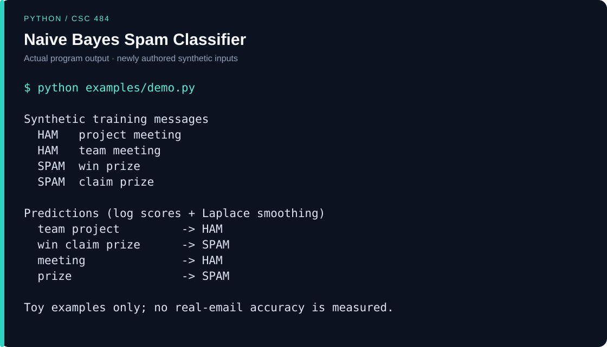

# Naive Bayes Spam Classifier

A Python multinomial Naive Bayes coursework implementation with class priors, word-frequency models, optional Laplace smoothing, direct/log probability scoring, and an F1 helper.

## Example walkthrough

`HAM` is class 0 and `SPAM` is class 1. The four tiny training messages and every prediction are visible. This demonstrates the mechanics; it is not a real-email accuracy or F1 result.



Run from the repository root. For Java, create `build` if it does not already exist:

```sh
python examples/demo.py
```

[Runnable example](examples/) · [Plain-text output](examples/output.txt)

The example and output visual were added for this portfolio in November 2026 using newly authored synthetic inputs. They are separate from the original coursework.

## Course and original date

- **Course / المادة:** CSC 484 - Information Retrieval / استرجاع المعلومات, King Saud University.
- **Original project period / تاريخ المشروع الأصلي:** Spring 2024; surviving source last saved 10 May 2024.
- **Evidence:** The local brief identifies CSC484 Project 2, Spring 2024. The selected `project2skeleton.py` implementation retains a 10 May 2024 modification date. The skeleton filename describes supplied coursework scaffolding and is not a claim that every line is original.

The original coursework dates above are distinct from the GitHub publication and maintenance date, **9 November 2026**. The original source files were preserved locally.

## Run

Python 3.9 or newer. Uses only the Python standard library.

```sh
python spam_classifier.py
```

## Verification

```sh
python -m unittest discover -s tests -v
```

9 unit tests and the synthetic CLI demonstration passed. Checks use newly authored synthetic inputs only. See [CHANGES.md](CHANGES.md) for the publication changes and validation scope.

## Scope and provenance

This is a small educational classifier, not a mail filter. Direct multiplication can underflow on long documents; log scoring with smoothing is recommended. Synthetic checks do not measure accuracy on real email.

Published from the owner's local coursework. Course briefs, slides, exams, student identifiers, faculty names, real datasets, collected email, credentials, IDE history, and compiled files are excluded. Academic material may include supplied interfaces or collaborative code; no claim of sole authorship of all scaffolding and no blanket license is made.

Course titles are cross-checked against the [KSU computer science course catalog](https://ccis.ksu.edu.sa/en/cs/cs-prog-guides). Original local evidence is retained privately rather than publishing the source briefs/reports.
